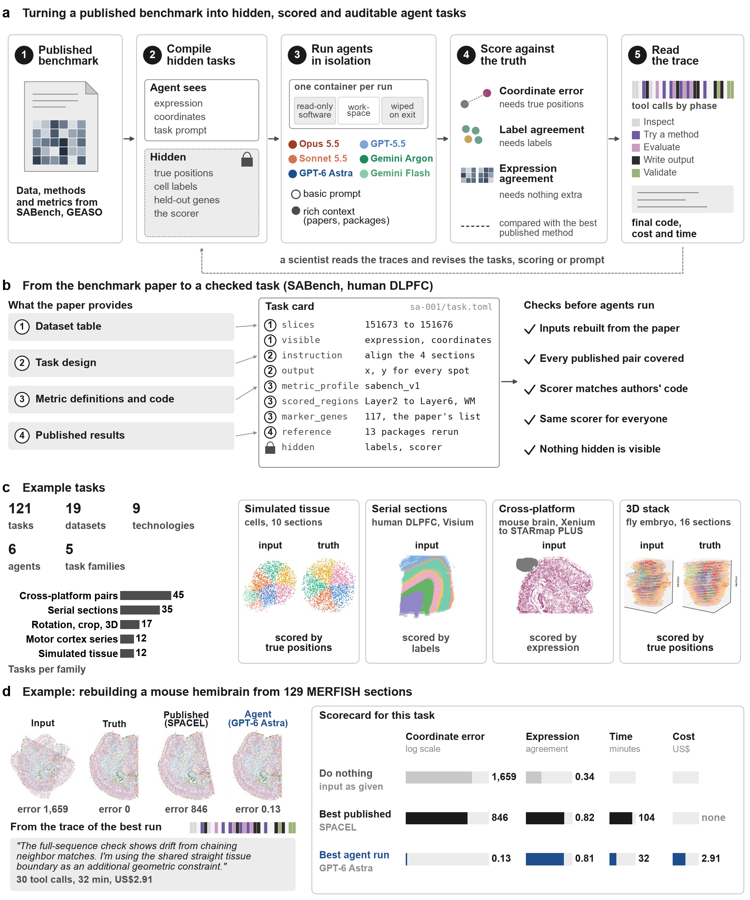

<p align="center">
  
</p>

<h1 align="center">Spatial Alignment Agent</h1>

<p align="center">A benchmark for coding agents in spatial transcriptomics</p>

<p align="center">
  <a href="https://ericzhy0815.github.io/agent-trace-explorer/">Trace Explorer</a> ·
  <a href="docs/TASK_CARDS.md">121 Task Cards</a> ·
  <a href="docs/RUNBOOK.md">Runbook</a> ·
  <a href="docs/DATA_ACCESS.md">Data Access</a>
</p>

A benchmark of coding agents (Claude Code, Codex, Gemini CLI) on spatial-transcriptomics
slice alignment. Each agent works blind inside a container: it sees the slices and the task
instructions but not the ground truth or the scorer. Its submission is scored with the
published benchmarks' own metrics and compared with scripted runs of the published methods.

| Task IDs | Source | What |
|---|---|---|
| sa-001 to sa-043 | SABench (Yan et al., *Nat. Comput. Sci.* 2026) | the paper's datasets, pairs and robustness sweeps |
| sa-101 to sa-112 | MOp MERFISH (Zhang et al. 2021) | the paper's 3D reconstruction pairs |
| sa-201 to sa-245 | adult mouse brain, one coronal region in many technologies | cross-technology pairs |
| sa-301 to sa-312 | Albis simulations | 3D stacks with known ground truth (coordinate MAE) |
| sa-401 to sa-417 | GEASO release, Open-ST, Zhuang ABCA-1 | 3D reconstruction at realistic difficulty |

## Explore the results

Browse runs, submitted code, alignments and figures in the
[Agent Trace Explorer](https://ericzhy0815.github.io/agent-trace-explorer/).

<details>
<summary>View the benchmark overview</summary>



Figure snapshot from the explorer; see [provenance and the figure list](docs/TRACE_EXPLORER.md).

</details>

The 121 benchmark tasks have committed specifications, instructions and manifests.
Browse the [task cards](docs/TASK_CARDS.md); large input files are distributed separately.

## Layout

```
benchmarks/spatial_alignment/
  tasks/<id>/task.toml       one directory per task: slices, instructions, metric profile
  task_registry.toml         declarative source the tasks are built from
  spatial_method_envs.toml   the per-method Python environments agents may use
  campaigns/                 run matrices and task orders for each campaign
  generalization/            held-out folds for the strategy-synthesis experiment
src/genomics_agent_bench/    scorer, metrics, containment, task specs
src/paper2bench/             task-card framework (used by scripts/build_tasks.py)
scripts/                     see scripts/README.md for an index by stage
containers/                  Apptainer definition of the blind container
tests/
results/                     small summary tables and figures (large outputs go on Zenodo)
references/                  published source data and SABench notebooks, for metric parity
docs/
```

## Docs

- `docs/BENCHMARK.md`: benchmark design, the run matrix, the bare and equipped conditions.
- `docs/RUNBOOK.md`: running agents and baselines on a Slurm cluster.
- `docs/DATA_SOURCES.md`: where every dataset came from and how it became task inputs.
- `docs/ALBIS_SIM_TASKS.md`, `docs/ALBIS_SCORING.md`: the simulated tasks and their scoring.
- `docs/PAPER_METHOD_PRIORS.md`: what the equipped condition tells agents about published methods.
- `docs/CREDENTIALS.md`: how each agent CLI is authenticated. No secrets are in the repo.
- `docs/audits/`: metric parity with the papers' code, data isolation, sanitisation.

## Data

This dataset supports 121 benchmark tasks for evaluating coding agents on spatial transcriptomics alignment. It combines published tissue datasets and Albis simulations spanning serial-section alignment, cross-technology matching, robustness tests, and three-dimensional reconstruction. Compiled AnnData (`.h5ad`) files provide gene-expression measurements, spatial coordinates, and reference annotations where available. Each task is accompanied by instructions, input and output specifications, data provenance, and a defined scoring profile. The benchmark separates agent-visible inputs from reference information used for evaluation and compares submitted alignments with scripted implementations of published methods.

Source: [Zenodo, doi:10.5281/zenodo.24043338](https://doi.org/10.5281/zenodo.24043338).

See [data access and local configuration](docs/DATA_ACCESS.md) and
[dataset provenance](docs/DATA_SOURCES.md).

## Setup

```bash
uv sync                                     # Python 3.11; see pyproject.toml and uv.lock
export HDF5_USE_FILE_LOCKING=FALSE          # needed on network filesystems
PYTHONPATH=src python -m unittest discover tests
PYTHONPATH=src python scripts/build_tasks.py --check-coverage
```

To run one agent on one task end to end, see `scripts/run_e2e_smoke.sh` and `docs/RUNBOOK.md`.
