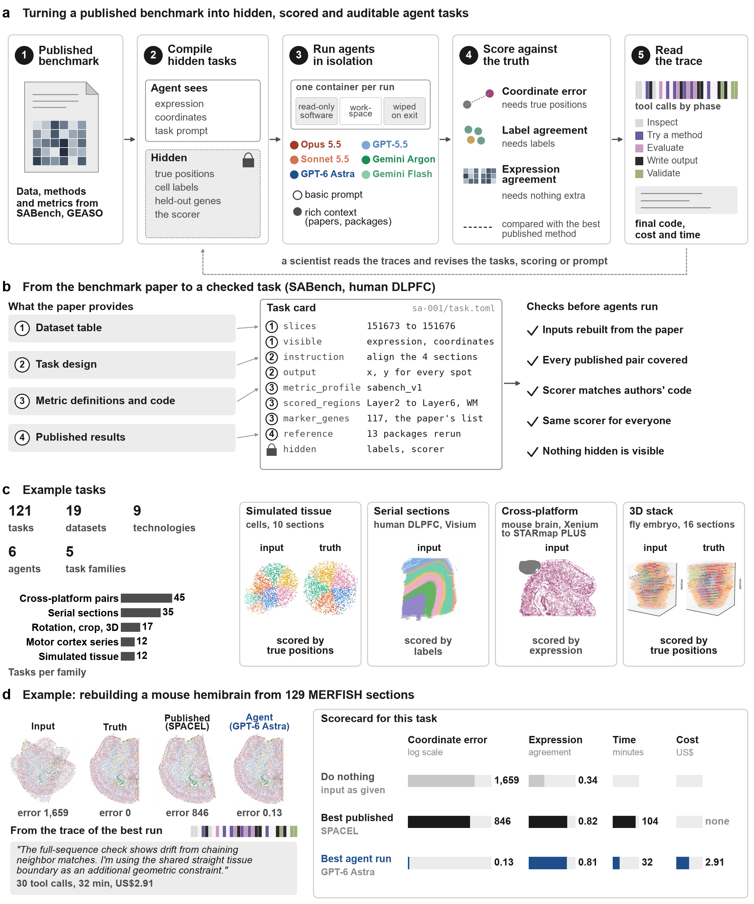

# Agent Trace Explorer

[Open the interactive explorer](https://ericzhy0815.github.io/agent-trace-explorer/)
for run traces, submitted code, alignment views and figures.

The site's figure gallery currently lists:

1. Overview — task construction, isolation, scoring and example alignments.
2. Agents against published methods.
3. Rich context.
4. Scores.
5. Working styles.
6. Generalization.
7. Selection.

## Committed example

Downloaded unchanged on 2026-11-07 from
[fig1_overview.png](https://ericzhy0815.github.io/agent-trace-explorer/figures/out/fig1_overview.png).
This is a snapshot of the explorer's figure, including its model labels and results;
it is not regenerated from this checkout and may change independently of this repository.
The gallery source is the `FIGS` list in the site's HTML.
